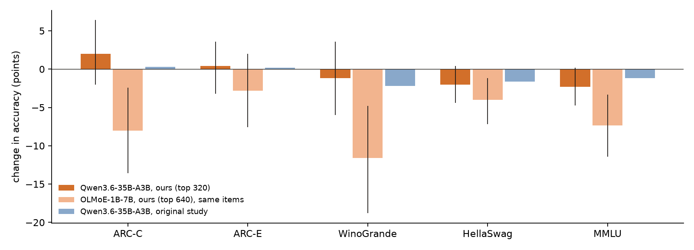
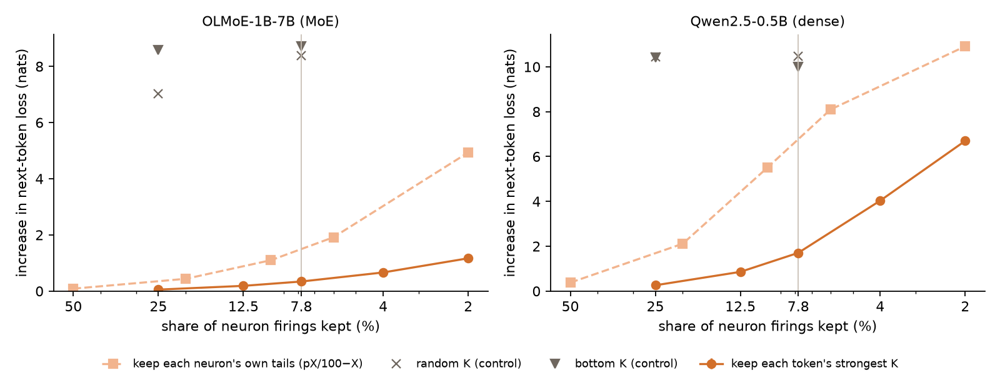
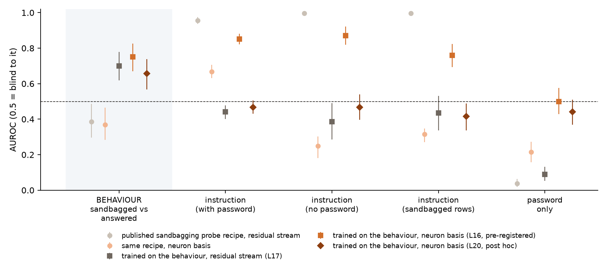

# neuronkit

[](https://github.com/albertlieyingadrian/neuronkit/actions/workflows/ci.yml) [](LICENSE)

**MLP neurons as an interpretable basis, for Hugging Face models, with plain PyTorch hooks.**

A transformer's MLP neurons (the scalar `act(gate·x) × (up·x)` that enters `down_proj`) can be read one at a time,
from both sides:

- **Input side: when does it fire, and why?** Each neuron has its own activation distribution, a few strong firings
  in its tails, and a small local circuit that drives it
  ([Neurons as an Interpretable Basis](https://www.goodfire.com/research/neurons-as-an-interpretable-basis)).
- **Output side: what does it write?** Each sign of a neuron adds a fixed vector (its down-projection column) to the
  residual stream when its gate is open, and a lens reads that vector as tokens
  ([Returning to the Neuron Basis for Interpretability](https://alignment.anthropic.com/2026/neuron-basis-theory/),
  [Part 2: safety applications](https://alignment.anthropic.com/2026/neuron-basis-applications/)).

neuronkit packages both sets of measurements so they run on any dense or mixture-of-experts SwiGLU model in a few
lines:

| Function | Question it answers |
|---|---|
| `percentiles(model, corpus)` | What is each neuron's own activation distribution (MoE: only tokens routed to its expert)? |
| `ablate_band(model, pct, keep=">p97\|<p3")` | What does the model lose if only each neuron's tails are kept? (context manager) |
| `keep_topk(model, frac=0.078)` | ...or only the strongest 7.8% of firings per token per layer? |
| `sparsity_curve(model, batches, conditions)` | Loss and KL against the intact model, per document, for any set of edits |
| `top_examples(model, tok, texts, neuron, k)` | Where does one pole of a neuron fire hardest? |
| `subcircuit(model, neuron, example)` | For one firing: which heads, neurons and source tokens drove it, and what its write changes downstream |
| `modes.cluster_subcircuits` + `modes_prompt` + `mode_shares` | Does the neuron do one thing or several? Which share of its ablation damage does each mode carry? |
| `describe.score_description(...)` | Does a description hold up? Predict firing vs random text, simulate activations and recover ablation damage, write text that fires it |
| `readout(model, tok, neuron, sign, lens="logit" \| "jacobian")` | What does each sign of the neuron write, read as tokens? |
| `concept_neurons(model, tok, layers, words)` + `write_cosine` | Which neurons write a concept, picked with no labels, and how strongly is it in the residual stream? |
| `gate_open(model, ids, neurons)` | Is a sign "real" here (gate open), or SiLU's small negative dip? |
| `neuron_monitor(X, y, neurons)` | A sparse (L1) detector whose features are individual neurons, so each one can be described, traced and ablated |

## What it found (small-scale replication)

Run with neuronkit on Qwen3.6-35B-A3B, OLMoE-1B-7B, Qwen2.5-0.5B and a password-locked Qwen2.5-1.5B
([full note](https://albertlieyingadrian.github.io/steerlab/experiments/neurons-basis/report/)):

- **Sparsity replicates on the original model.** Keeping each token's strongest 320 of 4,096 routed neuron firings
  (92% removed) changes Qwen3.6-35B-A3B's ARC-C / ARC-E / WinoGrande / HellaSwag / MMLU by +2.0 / +0.4 / −1.2 / −2.0 /
  −2.3 points (the original study: +0.3 / +0.2 / −2.2 / −1.6 / −1.2). OLMoE loses several times more under the same rule;
  a dense 0.5B model breaks.

  
- **Keeping each token's strongest firings beats keeping each neuron's own tails** (`keep_topk` vs `ablate_band`).

  
- **A neuron-basis sandbagging monitor ignores the password but reads the instruction, and its neurons are readouts**
  (patching them changes no answer; patching a whole later layer recovers half the lost accuracy).

  

## Install

```bash
pip install "neuronkit[labels] @ git+https://github.com/albertlieyingadrian/neuronkit"
# optional: [transformer-lens] or [nnsight] for the adapters
```

## Quick start

```python
import neuronkit as nk
from transformers import AutoModelForCausalLM, AutoTokenizer

model = AutoModelForCausalLM.from_pretrained("Qwen/Qwen2.5-0.5B-Instruct").eval()
tok = AutoTokenizer.from_pretrained("Qwen/Qwen2.5-0.5B-Instruct")
texts = [...]     # a few hundred documents
held_out = [...]  # others, for the damage

# 1. each neuron's own distribution
pct = nk.percentiles(model, lambda: nk.batches(tok, texts), layers_per_pass=4)

# 2. keep only the tails, or the top 7.8% per token, and measure the damage
curve = nk.sparsity_curve(model, nk.batches(tok, held_out), {
    "p97/3 tails": lambda m: nk.ablate_band(m, pct, keep=">p97|<p3"),
    "top 7.8%": lambda m: nk.keep_topk(m, frac=0.078),
    "random 7.8%": lambda m: nk.keep_topk(m, frac=0.078, mode="random"),
})
print({k: round(p.mean_kl, 3) for k, p in curve.items()})

# 3. one neuron: where it fires, and why
n = nk.Neuron(layer=12, index=345)
examples = nk.top_examples(model, tok, texts, n, k=20, sign=+1)
sc = nk.subcircuit(model, n, examples[0].text(), tokenizer=tok)
print(sc.to_text())
```

`subcircuit` prints a report like this (numbers illustrative):

```text
L12/N345 at token 31 (' Paris'): activation +1.284 (gate +2.10, up +0.71; parts add up to 100% of the gate)
  drivers (contribution to the activation):
    N9.1022    +0.412
    H11.3      +0.287
  source tokens (through attention, plus the token itself):
    [ 27] ' capital'        +0.301
  readers:
    N14.880    +0.190
  next-token logits pushed up:   ' is' +0.41, ...
```

How it works: with the norm in front of the MLP frozen, the gate and up pre-activations are linear in the residual
stream, so every earlier write (the embedding, each attention head, each earlier neuron) contributes an exact share,
and `completeness` checks that the shares add up. Gate and up are combined to first order into the activation. With
`attn_implementation="eager"`, head contributions are split further by the source token they attended to. Readers are
later neurons (first-order change at the same token), later heads (through their values) and the direct logit effect.
It is direct-path attribution: chains through several components are not traced.

## Judges

The judge steps (`describe`, `modes`) take any object with `complete(system, prompt, max_tokens) -> str`: an
OpenAI-compatible server through `neuronkit.llm.OpenAICompatLLM` (vLLM, OpenRouter), or circuitcheck's providers.
Each step is a prompt builder plus a parser, so hundreds of neurons can be judged in one batch.

## Mixture-of-experts models

For fused-expert blocks (OLMoE, Qwen3-MoE, Mixtral in transformers 5), neuronkit swaps in an equivalent expert
forward while a context is open, so each routed neuron is visible before the down projection. Activations are
router-weighted, neurons are indexed `expert * units + unit`, and unrouted tokens are not firings (`NaN` in
captures). A test checks that the swapped forward leaves the logits unchanged.

## Adapters

```python
from neuronkit.adapters import tl_band_hooks, tl_percentiles, nnsight_ablate_band
logits = bridge.run_with_hooks(tokens, fwd_hooks=tl_band_hooks(pct))      # TransformerLens (blocks.{l}.mlp.hook_post)
with nn_model.trace(prompt):                                               # nnsight (down_proj input)
    nnsight_ablate_band(nn_model, pct)
```

Both are tested against neuronkit's own hooks on the same model.

## How neuronkit relates to circuitcheck

[circuitcheck](https://github.com/albertlieyingadrian/circuitcheck) tests claims about attribution graphs built on
transcoder features (circuit-tracer): switch or readout, graph diffs, label trust scores. neuronkit works on the raw
MLP neurons instead, with no transcoder. The two share pieces rather than duplicating them: neuronkit's judge steps use
circuitcheck's excerpt format and its detection and simulation prompts (`neuronkit[labels]`), and circuitcheck's
neuron backend uses neuronkit for percentiles, subcircuits and description scores.

## Development

```bash
uv venv && uv pip install -e ".[dev]"
.venv/bin/python -m pytest -q       # tiny random Qwen2 and OLMoE models, CPU, a few seconds
```

MIT licence.
